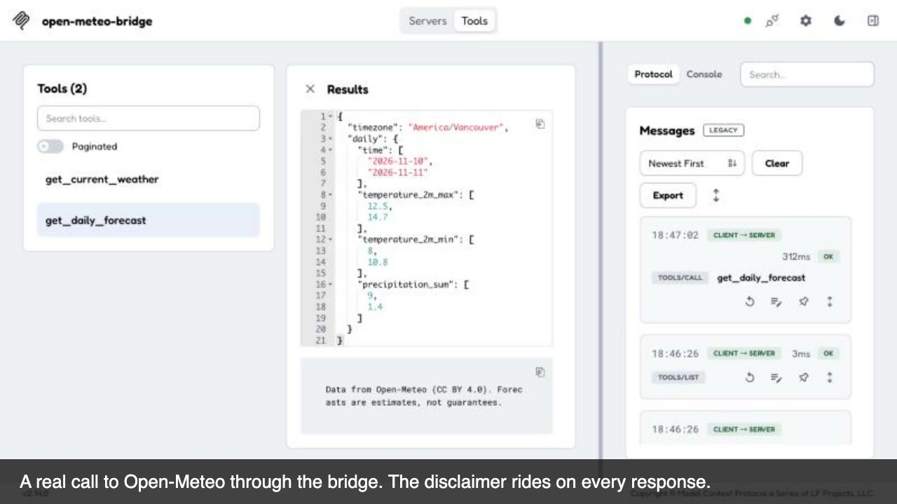

# mcp-api-bridge

Wrap any HTTP API as a Model Context Protocol (MCP) server from one JSON config file. No code per tool.
Built on the official `@modelcontextprotocol/sdk` (TypeScript, stdio transport) with the details clients ask for: input validation, timeouts, specific error messages, image responses, disclaimers, and a test suite against a mocked upstream.
Small enough to read in ten minutes and audit before you point it at a real API.

## 60-second demo

https://github.com/qqaiforrest/mcp-api-bridge/raw/main/docs/demo.mp4

[](https://github.com/qqaiforrest/mcp-api-bridge/raw/main/docs/demo.mp4)

Tests passing, one tool config, the MCP Inspector calling Open-Meteo through the bridge, the Claude Desktop config. Every frame is real output from this repo; the clip is assembled from those captures, not narrated.

## 60-second quickstart

```bash
git clone https://github.com/qqaiforrest/mcp-api-bridge && cd mcp-api-bridge
pnpm install
pnpm test                         # 11 tests against a local mock upstream
pnpm smoke                        # spawns the server over stdio and asks Open-Meteo for the weather in Victoria, BC
pnpm start -- --config examples/open-meteo.json   # the server itself, waiting on stdio
```

Point it at your own API: copy `examples/open-meteo.json`, change `baseUrl` and the tools, set `API_KEY` in the environment, start.

## Use it from Claude Desktop

`claude_desktop_config.json` (macOS: `~/Library/Application Support/Claude/claude_desktop_config.json`):

```json
{
  "mcpServers": {
    "open-meteo": {
      "command": "node",
      "args": ["/ABSOLUTE/PATH/mcp-api-bridge/dist/cli.js", "--config", "/ABSOLUTE/PATH/mcp-api-bridge/examples/open-meteo.json"],
      "env": { "API_BASE_URL": "https://api.open-meteo.com", "REQUEST_TIMEOUT_MS": "15000" }
    }
  }
}
```

Run `pnpm build` first so `dist/cli.js` exists. Restart Claude Desktop; the two tools appear under the hammer icon.

## Use it from Cursor

`.cursor/mcp.json` in your project (or the global one in `~/.cursor/mcp.json`):

```json
{
  "mcpServers": {
    "open-meteo": {
      "command": "node",
      "args": ["/ABSOLUTE/PATH/mcp-api-bridge/dist/cli.js", "--config", "/ABSOLUTE/PATH/mcp-api-bridge/examples/open-meteo.json"]
    }
  }
}
```

## Verify with the MCP Inspector

```bash
pnpm inspect    # tools/list through the Inspector CLI
npx -y @modelcontextprotocol/inspector@2.14.0 --cli -e MCP_API_BRIDGE_CONFIG=examples/open-meteo.json \
  node --import tsx src/cli.ts --method tools/call --tool-name get_daily_forecast \
  --tool-arg latitude=48.4284 --tool-arg longitude=-123.3656 --tool-arg forecast_days=2
```

The Inspector's own `--config` flag means "session file", so the bridge config is passed through the `MCP_API_BRIDGE_CONFIG` environment variable there.

Real transcript from 2026-11-10 (Inspector 2.14.0, Node 24):

```
$ npx -y @modelcontextprotocol/inspector@2.14.0 --cli -e MCP_API_BRIDGE_CONFIG=examples/open-meteo.json node --import tsx src/cli.ts --method tools/call --tool-name get_daily_forecast --tool-arg latitude=48.4284 --tool-arg longitude=-123.3656 --tool-arg forecast_days=2
{
  "content": [
    {
      "type": "text",
      "text": "{\n  \"timezone\": \"America/Vancouver\",\n  \"daily\": {\n    \"time\": [\"2026-11-10\", \"2026-11-11\"],\n    \"temperature_2m_max\": [12.8, 14.7],\n    \"temperature_2m_min\": [8, 10.8],\n    \"precipitation_sum\": [4, 0]\n  }\n}"
    },
    { "type": "text", "text": "Data from Open-Meteo (CC BY 4.0). Forecasts are estimates, not guarantees." }
  ]
}
```

`tools/list` on the same run returned both tools with their JSON schema (`minimum`/`maximum`, `enum`, `required`, `additionalProperties: false`) and the `readOnlyHint`/`openWorldHint` annotations.

## Config reference

Top level:

| Key | Required | Meaning |
|---|---|---|
| `name`, `version` | yes / no | Server identity shown to the client |
| `baseUrl` | no | Default upstream; `API_BASE_URL` overrides it |
| `disclaimer` | no | Text block appended to every tool response |
| `tools[]` | yes | At least one tool |

Per tool:

| Key | Meaning |
|---|---|
| `name` | Letters, digits, `_` or `-`, max 64. Must be unique |
| `description` | Say when to use the tool and when not. This is what the model reads |
| `method`, `path` | `GET/POST/PUT/PATCH/DELETE`; path may contain `{param}` placeholders |
| `inputs` | Map of argument name to an input spec (below) |
| `fixedQuery`, `fixedBody` | Constants sent on every call (`{"current_weather": "true"}`) |
| `exactlyOneOf` | Lists of optional inputs of which exactly one must be given |
| `response.pick` | Keep only these JSON fields (dot paths allowed) |
| `response.image` | `true` for an `image/*` body, or `{dataField, mimeType, summaryField}` for base64 in JSON; the answer becomes an MCP image content block |
| `annotations` | `readOnlyHint`, `destructiveHint`, `idempotentHint`, `openWorldHint` passed through to the client |
| `disclaimer` | Per-tool override of the top-level disclaimer |
| `retryOnce` | Retry once on timeout or 5xx. Never on 4xx. Default false |

Input spec:

| Key | Meaning |
|---|---|
| `type` | `string`, `number`, `integer`, `boolean`, `enum`, `file` (path on the server machine, uploaded as multipart), `base64` (decoded and uploaded as multipart) |
| `in` | `path`, `query`, `body` (JSON), `multipart` |
| `fieldName` | Name in the request when it differs from the argument name |
| `optional` | Default false. Path inputs cannot be optional |
| `enum`, `min`, `max`, `minLength`, `maxLength` | Validation, also advertised in the JSON schema |
| `description` | Shown to the model in the schema |
| `fileName`, `mimeType` | For multipart parts |

The loader refuses configs that cannot work: a `{param}` without a matching path input, a GET with a body, an `exactlyOneOf` member that is not optional, duplicate tool names.

Environment: `API_BASE_URL`, `API_KEY`, `API_KEY_HEADER` (default `Authorization`), `API_KEY_PREFIX` (default `Bearer `), `REQUEST_TIMEOUT_MS` (default 15000). See `.env.example`.

## Add a tool

One block in the config, no code:

```json
{
  "name": "get_order",
  "description": "Fetch one order by its id. Use list_orders when the id is unknown.",
  "method": "GET",
  "path": "/v2/orders/{order_id}",
  "inputs": { "order_id": { "type": "string", "in": "path", "minLength": 4 } },
  "response": { "pick": ["id", "status", "total", "customer.email"] },
  "annotations": { "readOnlyHint": true }
}
```

For an image-returning endpoint see `explain_prediction` in `examples/image-classifier.json`, which also shows `file`/`base64` inputs with an exactly-one-of rule and a research-use disclaimer. The test suite runs that example against a mock classifier.

## What the model sees when things go wrong

Every failure is returned as an `isError` result with one short sentence that says what happened and what to do, so the assistant can correct itself or stop:

| Situation | Message starts with |
|---|---|
| Invalid arguments | The SDK's schema error (missing field, out of range, unknown key); the upstream is never called |
| None or both of an exactly-one-of pair | `give exactly one of image_path, image_base64 (got ...)` |
| File path unreadable | `cannot read file "..." for input image_path: ENOENT` |
| 400 / 422 | `upstream rejected the input (400) for POST /v1/predict: <detail>; fix the argument it names` |
| 401 / 403 | `upstream refused authentication (401); API_KEY is missing or wrong in the server environment` |
| 404 | `upstream path not found (404): GET /items/x; the API may have moved` |
| 429 | `upstream rate limit (429) ...; wait before calling again` |
| 5xx | `upstream server error (503) ...; retry later` |
| Timeout | `upstream did not answer within 15000 ms ...; retry once, and reduce the input size` |
| Network | `could not reach upstream at host:port: ECONNREFUSED; check API_BASE_URL` |

## Security notes

- Keys come from the environment only. The config file holds no secrets and can be committed.
- The server runs no shell commands and reads files only for inputs declared as `type: "file"`, and only the path the caller passes.
- Tools carry `readOnlyHint` / `destructiveHint` annotations so clients can ask before a destructive call.
- Unknown arguments are rejected (`additionalProperties: false`), so a prompt cannot smuggle extra query parameters.
- Timeouts are enforced with `AbortController`; a hung upstream cannot hang the assistant.

## Related projects

- FastMCP (Python, Apache-2.0) can generate a server from an OpenAPI document. Choose it when you have a complete, trustworthy OpenAPI spec and a Python toolchain.
- Several npm packages generate MCP servers from OpenAPI or proxy whole APIs. They expose every endpoint; this template exposes only the handful of tools you describe, with descriptions written for the model.
- This project is deliberately small: six source files, no framework, one config. It is the shape we hand over to clients who need to read and own the code.

## Dependencies and licences

| Package | Version | Licence | Role |
|---|---|---|---|
| `@modelcontextprotocol/sdk` | 1.32.2 | MIT (project moving to Apache-2.0) | MCP protocol, stdio transport, schema validation |
| `zod` | 4.6.7 | MIT | Input schemas |
| `typescript` | 5.9.3 | Apache-2.0 | Build (dev) |
| `tsx` | 4.23.15 | MIT | Run TypeScript directly (dev) |
| `@types/node` | 26.6.6 | MIT | Types (dev) |
| `@modelcontextprotocol/inspector` | 2.14.0 | MIT (project moving to Apache-2.0) | Verification only, via `npx`, not installed |

Example data: Open-Meteo, CC BY 4.0, no key required.

## Licence

MIT, copyright 2026 QQAI.AI Inc. See `LICENSE`.
